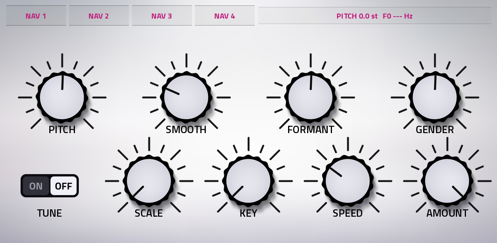

# ALPHA

OWN build and code, Manipulator by Polyverse & Vocal Synth Izotope had a baby.

A granular vocal transformer with an LFO, TUNE, ALIGN, 492 factory presets and a Panic tile for the Akai Force and MPC OS (Gen1, ARMv7), by L'Cronx and DreamX Wilson. Put it on a track's input or an audio
track's insert, sing or play a voice through it and move the pitch, the formant and the harmonics, with or without MIDI.
It is an effect plugin (VST2).

Independent clean-room plugin: the control list follows what a publicly documented plugin of this kind offers; the
DSP, the presets and the artwork are original. No code, sample, preset or name of another product is in it.

## Status
Version 1.2.0. Built for the ARMv7 Force and MPC OS 3.x. **Not yet run on a Force** (1.1.0 was the last build checked offline; ALIGN, TUNE and the new skin are untested on the device).

## Highlights
- Pitch-synchronous grains: Pitch (±24 st) and Formant (±12 st) move separately, Gender moves both.
- Harmonic shifter, Alternator, Smear, Detune and Stereo, Freeze and Reverse, Jitter, Window and Density.
- MIDI voices: Off, Mono, Poly, Mono Gated, Poly Gated, with Glide, Attack and Release.
- Four modulation slots, six sources (Meta Knob, MIDI, Sequencer, Follower, ADSR, LFO), 16 targets, cross-modulation.
- LFO: 7 waves, free rate or tempo sync, phase, retrigger.
- **New in 1.2.0:** TUNE (22 scales, key, speed, amount, on the Pitch page), ALIGN (Global page) and a new white skin.
- 492 wired-in factory presets (60 TUNE presets), plus user presets 1-9999 saved as plain text.
- START page with the six controls that matter most, and a PANIC tile on every page.
- 100 % wet is only the effect (Consonant protect is off by default).

## Pages
START, PITCH, HARMONICS, ALTERNATOR, GRAINS, EFFECTS, MIDI, MOD SOURCE, MOD AMOUNTS, SEQUENCER, USER PRESETS, GLOBAL.
The 16 Q-Links follow the page you are on. Details in [docs/USER_GUIDE.md](docs/USER_GUIDE.md).

## Requirements
A first-generation MPC OS device (32-bit ARM: Force, MPC Live / Live II, One, X, Key 61), MPC OS 3.x, and root (SSH) access.
Installing plugins this way is unofficial: back up first, use at your own risk.

## Latest release
See the Releases page for `ALPHA-1.2.0-mpc-armv7.zip` and [CHANGELOG.md](CHANGELOG.md).

## What it does
Signal flow: input, Smear, grains (Pitch, Formant, Smooth Grains, Alternator, MIDI voices, Jitter, Window, Density, Freeze,
Reverse), TUNE, Harmonic shifter (Harmonics, Ratio, FM), Detune, Stereo, Dry/Wet.
See [docs/USER_GUIDE.md](docs/USER_GUIDE.md).

## Install
Unzip the release and run `install.sh` (or follow the generated INSTALL.md). `uninstall.sh` removes it.
User presets are stored in the `presets` folder beside the plugin.

## Tested
1.1.0 was checked offline on a desktop (x86): the framework's ASan/UBSan port test and `test/dsp_test.cc`. 1.2.0 was not run on x86 or a Force. **Not yet run on a Force:** CPU use on the device, whether MIDI reaches an effect plugin on
each firmware, Q-Link and touch behaviour, and the look of the skin. `tested.json` stays empty until a device test is done.

Latency (measured on a click, dry path): Detect High 21 ms, Mid 33 ms, Low 58 ms.

## Build
The framework is not vendored: clone <https://github.com/sunskiefer/mpc-vst-plugins> into `third_party/mpc-vst-plugins` (or set `MPC_VST`).
`./build.sh` (needs Python 3 with Pillow, a host gcc for the skin art, and `pip install ziglang`). Output:
`build/package/L'Cronx - VST - ALPHA/`. Release zip: `tools/release_quotes.py` then the framework's `tools/release.py`
(see `docs/RELEASING.md` of mpc-vst-plugins).

## License
PolyForm Noncommercial License 1.0.0 (LICENSE, NOTICE). Free for noncommercial use; contact the author for anything commercial.

## Skin art
The 1.2.0 skin is the generated skin (`./build.sh`) post-processed with the scripts in `tools/skin/` (filmstrips from `art/skin/`, selectors, option cells, the layout exported from the panel editor). They are kept as run in the build session (absolute paths inside): a record of how the shipped skin was made, not a one-command build.
